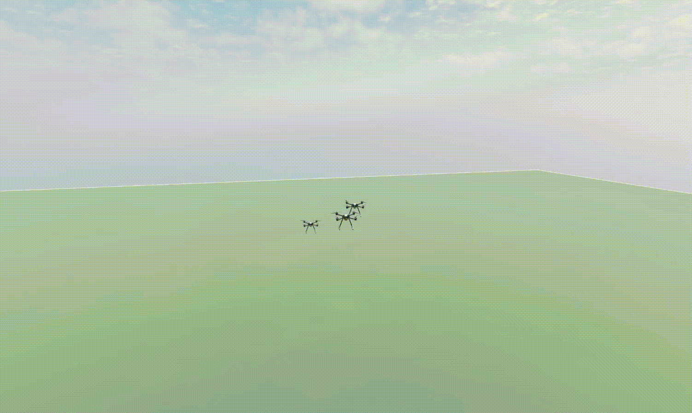

# Leader-Follower PX4 Swarm Simulation


Spin up a **multi-drone PX4 swarm in Gazebo with one command**, let the drones **elect a leader automatically**, and fly a **mission that the whole swarm follows**: no QGroundControl clicking, no per-drone setup.

<table>
  <tr>
    <td></td>
    <td></td>
  </tr>
</table>

## ✨ Features

- **One-script multi-drone simulation**: `launch.sh -n 5` starts 5 PX4 drones in any Gazebo world.
- **Automatic leader election**: bully algorithm over MAVLink; a new leader is elected if the current one goes silent.
- **Formation following**: followers switch to offboard mode and track the leader in real time.
- **Mission upload from the terminal**: `mission` uploads any QGroundControl `.plan` to the current leader and starts it.
- **Common commands for the whole swarm**: `takeoff`, `land` and `return` go to every drone at once, or to a single drone.
- **Fully automated**: four scripts start QGroundControl, the PX4 ↔ ROS 2 bridge, the simulation and the ROS 2 nodes.

## ⚙️ How it works

| Component | Role |
|---|---|
| `election_node` (one per drone) | runs the leader election and publishes the leader's position |
| `controller_node` (one per drone) | executes commands; makes followers track the leader in offboard mode |
| `swarm_manager_node` | monitors drone heartbeats and publishes the swarm status |
| Micro XRCE-DDS Agent | bridges PX4 topics into ROS 2 |

## 🧩 Version compatibility

| Component | Version |
|---|---|
| PX4-Autopilot | **v1.17.x** (tested with v1.17.0) |
| `px4_msgs` (submodule `ros2_ws/src/px4_msgs`) | branch **release/1.17** |
| Gazebo | Harmonic |

`px4_msgs` must come from the same PX4 release as your PX4 build. If they don't match, the ROS 2 nodes
get no data from PX4 and keep printing `No status updates received yet`.

## 📦 Installation

**1. Clone this repo.** All `cd` paths below are relative to its root folder.

```bash
git clone --recursive https://github.com/ahmedmsalah99/Leader-Follower-PX4-Simulation.git
cd Leader-Follower-PX4-Simulation
```

**2. Install PX4 v1.17.0** in any folder outside this repo:

```bash
git clone -b v1.17.0 --recursive https://github.com/PX4/PX4-Autopilot.git
cd PX4-Autopilot
bash ./Tools/setup/ubuntu.sh   # installs dependencies and Gazebo, reboot afterwards
make px4_sitl
```

Already have PX4? Switch it to the release and rebuild:

```bash
cd PX4-Autopilot
git fetch --tags && git checkout v1.17.0
git submodule update --init --recursive
make distclean && make px4_sitl
```

**3. Build the Micro XRCE-DDS Agent**

```bash
cd SITL/Micro-XRCE-DDS-Agent
mkdir build && cd build
cmake .. && make
sudo make install && sudo ldconfig /usr/local/lib/
```

**4. Build the ROS 2 workspace** (with ROS 2 sourced; `pymavlink` comes with PX4's `ubuntu.sh`)

```bash
cd ros2_ws
colcon build
```

**5. QGroundControl:** download the [AppImage](https://docs.qgroundcontrol.com/master/en/qgc-user-guide/getting_started/download_and_install.html) and place it at `SITL/QGroundControl.AppImage`.

## 🚀 Quick start

Open **4 terminals** in the repo root and paste one block into each, in order.

**Terminal 1: QGroundControl + PX4 ↔ ROS 2 bridge**

```bash
cd SITL/automation_scripts
./init.sh
```

**Terminal 2: Gazebo with 3 drones on the green `lawn` world**

```bash
cd SITL/automation_scripts
export PX4_PATH=/path/to/PX4-Autopilot   # your PX4 folder
./launch.sh -n 3 -w lawn
```

**Terminal 3: ROS 2 nodes (election, controllers, swarm manager)**

```bash
cd SITL/automation_scripts
./start_system.sh -n 3
```

**Terminal 4: command the swarm** (once the leader is elected)

```bash
cd SITL/automation_scripts
./command_drone.sh 3
```

Then type at the `>` prompt:

```text
> takeoff
> mission
> land
```

## 🎮 Commands

### `command_drone.sh`

Leave out the drone number `N` to send the command to **all** drones.

| Command | Effect |
|---|---|
| `takeoff [N]` | arm and take off (1.5 m above home) |
| `land [N]` | land |
| `return [N]` | return to launch |
| `mission [plan_file]` | the current leader flies a QGroundControl `.plan` (default `SITL/missions/simple_mission.plan`) |
| `help` / `exit` | show the commands / quit |

By default the drone with the highest number becomes the leader.

### `launch.sh`

| Option | Meaning |
|---|---|
| `-n N` | number of drones (default 1) |
| `-w WORLD` | Gazebo world, any file name in `$PX4_PATH/Tools/simulation/gz/worlds` without `.sdf`, e.g. `lawn`, `default`, `windy` (default `default`) |
| `-h` | headless (no Gazebo GUI) |

## 💡 Examples

5 drones on `lawn` without the Gazebo GUI (Terminals 2 and 3):

```bash
./launch.sh -n 5 -w lawn -h
./start_system.sh -n 5
```

Command a single drone, or fly your own plan (Terminal 4):

```text
> takeoff 2
> return 2
> mission /path/to/my_route.plan
```

## 📝 Notes

- `simple_mission.plan` uses coordinates near the `default` world origin, shared by `lawn`, `windy` and
  `default`. Worlds at a different location (e.g. `baylands`) need their own plan: draw it in QGroundControl
  and save it as a `.plan`. Only simple waypoint items are supported (no survey/complex items).
- After changing code or `px4_msgs`, run `colcon build` again.
- `No status updates received yet` means PX4 data isn't arriving: check that the agent is running
  (Terminal 1) and that `ros2 topic list | grep vehicle_status` shows `/px4_1/fmu/out/vehicle_status_v1`;
  a different name means PX4 and `px4_msgs` versions don't match.

## 📜 License

MIT
